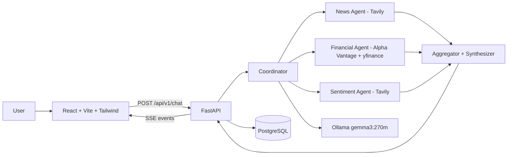

# HLD — Multi-Agent Financial Intelligence Platform
## System Context
Users ask company questions in a React console. FastAPI delegates to a Coordinator that runs News, Financial and Sentiment agents in parallel. Ollama (Gemma 3:270m) provides local synthesis; Tavily, Alpha Vantage and yfinance provide grounded external data. PostgreSQL persists executions/events; SSE streams live events to the browser.

## Functional Requirements
Chat with ticker extraction; parallel research; grounded synthesis with sources; live agent/tool/model observability; execution history; prompt inspection (LOG_PROMPTS gated).
## Non-Functional Requirements
Bounded retries/timeouts, partial-result tolerance, no secret logging, no Groq fallback, modular monolith, async I/O.
## Deployment
Three processes for dev (Ollama via Docker, backend via uv/uvicorn :8000, frontend via Vite :5173). Postgres via the same compose file. If the backend is containerized, use the `ollama` service hostname instead of localhost.
## Trade-offs
Deterministic orchestration over LLM tool-calling because Gemma 3:270m tool-calling is unreliable; LLM is used for synthesis only and is optional. SSE over WebSockets because events are server→client only.
