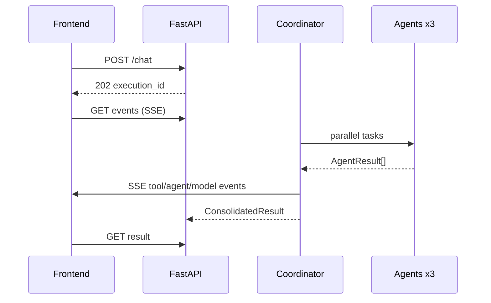

# LLD
## Modules
- `app/core`: Settings (pydantic-settings), logging, exceptions, constants/ticker map.
- `app/models`: LLMProvider ABC, OllamaProvider (httpx /api/generate + Strands adapter hook), BedrockProvider (Strands, explicit only), factory (never Groq).
- `app/tools`: tavily_search, alpha_vantage_quote, yfinance_history (+ pure parsers for contract tests), tool_registry.
- `app/agents`: prompt_loader, coordinator (ticker extraction + fallback synthesis), news/financial/sentiment runners, agent_factory.
- `app/orchestration`: ExecutionContext, EventPublisher (dedup by event_id, SSE fan-out), orchestrator (parallel gather, retries, validation, synthesis), result_aggregator.
- `app/db`: SQLAlchemy async models (conversations, executions, agent_executions, execution_events, agent_results, prompt_versions), session, Alembic.
- `app/api/routes`: health, chat (202 + background execution), executions (status/result/SSE), agents+prompts.
## Schemas
AgentResult(agent_name, execution_id, status, summary, findings, sources, financials, sentiment, started_at, completed_at, error, confidence); ExecutionEvent(event_id, execution_id, conversation_id, event_type, agent_name, timestamp, duration_ms, payload); FinancialValue carries value/currency/source/market_timestamp/retrieved_at.
## Sequence

## Errors
ToolError → agent partial; provider unavailable → template synthesis retained + model.error event; timeouts bounded by agent_timeout_s.
